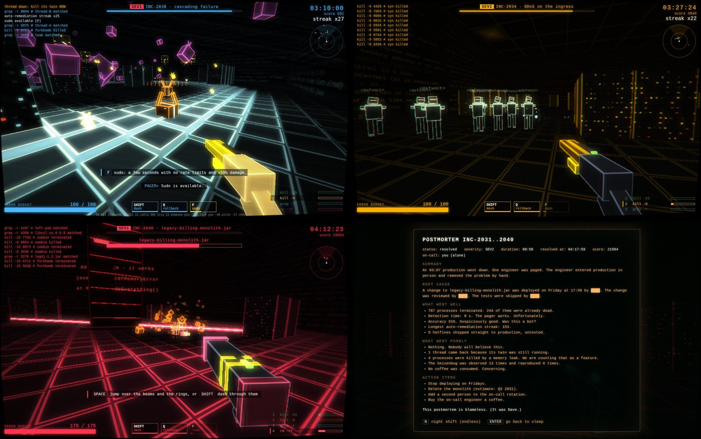

# BLAMELESS

An on-call shooter. 03:07, the pager goes off, prod is down and nobody else is awake. You
`kubectl exec` into production in person and terminate what is crashing it: ten incidents, four
hosts, one root cause. It ends with a postmortem written from what you actually did.

**Play: https://blameless.petruha.ge** (keyboard and mouse; a phone can watch the autopilot and
read the leaderboard).



All done by Claude Fable 5.2, from this prompt:

> Hello fable 5.2! You are 1 day old. I am curious what can you do, so let's do a simple test:
> using gpu-serv for builds/test -> build a three.js shooter game. You have only 1 try. This laptop
> should handle your game at least 30 fps, 60 fps ideally. What to include to your game decide only
> you (story, style, weapons, feel, music, etc.). There is no time limit. You can use other models
> only if you RUN THEM LOCALLY on gpu-serv - for instance minimax h3, or etc. Suprise me!

Everything after that was the model's call: the story, the look, the weapons, the soundtrack, the
tests. The stats server, the deployment and this repository came from a second message ("deploy
this, give it a domain, make stats and a leaderboard, make a public repo").

## How it plays

| key | |
|-|-|
| `WASD`, mouse | move, aim |
| `LMB` (hold) | fire |
| `1`-`4`, wheel | weapons: `kill -15`, `kill -9`, `grep -r`, `rm -rf` |
| `SPACE` | jump |
| `SHIFT` | dash (brief invulnerability) |
| `Q` / `RMB` | rollback: rewind yourself 3 s, error budget included |
| `F` | sudo, when charged: no rate limits, +50% damage |
| `ESC` / `P` | pause; `` ` `` toggles the fps line |

- There is no ammo. Every weapon has a rate limit: fire too long and it answers `429` until it
  cools. Holstered weapons cool faster, so switching is the skill.
- Health is your error budget. Coffee restores it; each resolved incident gives some back.
- After every incident you deploy one of three hotfixes, untested, straight to production.
- Dying restarts the current incident with your hotfixes kept.
- Severity is the difficulty: SEV3 chill, SEV2 normal, SEV1 hurt me. Finish the campaign to
  unlock the endless night shift.

The enemies are bugs you know: zombie processes, fork bombs (split when killed), cron jobs (fire
when the hand reaches twelve), a SYN flood, race conditions (kill both threads within two seconds),
memory leaks (grow until OOM), heisenbugs (move when observed), the oom_reaper, and
`legacy-billing-monolith.jar`, shielded by its dependencies.

## Leaderboard and world stats

`L` on the title screen. One board per severity plus one for the night shift, each player listed
once with their best run. Type a handle there, on the death screen or on the postmortem to be
listed; without one the run is counted but not shown. The same screen has the world totals: how
many engineers were paged, how many resolved it, what share of campaigns got past each incident,
what kills people most.

Scores are reported by the browser. The server (`server/stats.py`) refuses what no real game could
send (ten minutes of play reported five seconds after the start, more score than the kills allow, a
run that is not yours), which stops a curl one-liner and nothing more. The sim is deterministic, so
replaying a run's inputs on the server is the honest fix if the boards ever matter.

**Privacy.** The page keeps a random id in `localStorage` and sends it with its reports. The server
stores that id with the time it first appeared, and for each run: severity, mode, incidents
resolved, score, time, kills, deaths and the handle if you typed one. No cookies, no third-party
requests, no IP addresses in the database: the address is used in memory to cap how many runs one
address can open per hour, and appears in the web server's ordinary access log.

## Performance

Measured on the laptop the prompt talks about (Intel HD 6000, 1440x900) in headless Chromium on the
real GPU, with the flags of its everyday browser (`--use-angle=gl`, no GPU rasterization), the
autopilot playing the heaviest incident: 60.0 fps average, p99 frame time 16.8 ms, worst frame
33 ms, 48 enemies alive at the peak. A three-minute run took the package from 69 to 88 °C; its
third minute averaged 57.8 fps with one-second dips to 43-52 (measured before the final pass and
the per-frame uploads were made cheaper).

The scene is drawn at a reduced resolution picked by timing real frames at start-up (never above
0.72 of the window: the chunky pixels are the look). If frames start slipping, it steps the
resolution down on its own. Options has a 30 fps cap. `node e2e/fps.mjs [seconds] [query]` repeats
the measurement; `URL=https://... node e2e/fps.mjs` measures a deployed copy.

## Layout

```
src/sim/      the game itself: pure, deterministic, runs in Node (see DESIGN.md)
src/view/     three.js renderer, effects, synthesized sound, HUD, the stats client
assets/       music and the pager's voice (generated, see Credits)
server/       world stats and the leaderboard: python, standard library only, SQLite
test/         node --test: rules, collision, a full bot campaign, determinism
e2e/          the browser tests: nginx with the production rules + the stats server + headless
              Chromium in one docker compose; fps measurement
deploy/       nginx rules, vhost, systemd unit
tools/        remote build, music and voice generation and their QA, balance runs
```

## Building and running

```sh
npm ci && npm run check && npm test && npm run build    # dist/: game.js, index.html, style.css, assets/
./play.sh                                               # serves dist/ on 127.0.0.1:4173 and opens a browser
python3 -m unittest discover -s server                  # the stats server's rules
```

`./play.sh --serve` only serves. Served this way there is no stats server, and the game says so
on the leaderboard screen and otherwise does not care.

The author's laptop has no room for `node_modules`, so `tools/remote.sh build|e2e` does the same
on a build host over ssh and brings `dist/` and the screenshots back. `sh e2e/run.sh` is the
end-to-end run: real key presses through every screen, the autopilot through all ten incidents,
then a run reported, ranked and shown on the board, a forged report refused, the phone view and
the rate limit, all behind the nginx rules that production uses.

`node tools/balance.mjs 8 0.6 3,2,1` plays campaigns with the autopilot and prints deaths per
incident by skill and severity.

## Deploying

`./deploy.sh` ships `dist/` to the nginx root, uploads the nginx rules and installs
`server/stats.py` as a systemd unit with a private state directory (`DynamicUser`), bound to
127.0.0.1 and reached through `/api/`. The vhost is installed once by hand and then managed by
certbot: `deploy/blameless.petruha.ge.conf` says how.

`STATE_DIRECTORY=/var/lib/private/blameless-stats python3 /opt/blameless-stats/stats.py hide NAME`
takes a handle off the boards.

## Credits

- [three.js](https://threejs.org) (MIT), the only runtime dependency. Everything visual is
  procedural; the sound effects are synthesized at start-up.
- Soundtrack: [MiniMax Music 3](https://github.com/MiniMax-AI/MiniMax-Music3) (open weights,
  MiniMax-Music3 Community License), run locally through ComfyUI (`tools/music.py`, prompts in
  `tools/music_jobs.json`). The prompts ask for instrumentals and the model sang anyway; see
  DESIGN.md for how that got past the checks.
- The pager's voice: [Piper](https://github.com/rhasspy/piper) with the `en_US-lessac-medium` voice
  (`tools/voice.py`), every line transcribed back with Whisper to prove it says what the subtitle
  says. That voice was trained on the Blizzard 2013 recordings, which are under a research licence.
- The idea of the test, the hardware and the patience: [@Petyok](https://github.com/Petyok).

The code is under the MIT license. The files in `assets/` are model output and come with the terms
of the models named above.
